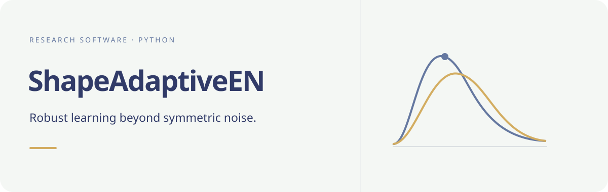

# Shape-adaptive robust regression

[Documentation](https://byuzbasi.github.io/shape-adaptive-robust-regression/) · [Get started](https://byuzbasi.github.io/shape-adaptive-robust-regression/getting-started/) · [API](https://byuzbasi.github.io/shape-adaptive-robust-regression/reference/)



*Conceptual residual-shape illustration, not an estimated distribution.*

Installable Python estimators for *From Residual-Moment
Penalties to Shape-Adaptive Robust Estimation under Skewness and Heavy Tails*
by Mohammad Arashi and Bahadır Yüzbaşı.

The proposed method is shape-adaptive elastic net (SA-EN). The package also
exposes the shape-penalized and comparison estimators used in the paper.
The estimator implementation is an unchanged copy of the validated v4 study
module. This repository provides the installable estimator API and a small
installation test. The paper's data, application scripts, simulation scripts,
generated results and manuscript are not included.

## Requirements and installation

Python 3.13 is required. The package pins its numerical dependencies to the
versions used in the validated study. A virtual environment is recommended.
From a local repository checkout:

```sh
cd shape-adaptive-robust-regression
python3.13 -m venv .venv
. .venv/bin/activate
python -m pip install .
python -c "from shape_adaptive_robust_regression import ShapeAdaptiveEN; print(ShapeAdaptiveEN)"
```

The estimator package can also be installed directly from GitHub:

```sh
python3.13 -m pip install 'shape-adaptive-robust-regression @ git+https://github.com/byuzbasi/shape-adaptive-robust-regression.git'
```

This repository is not a PyPI release. The local installation command also
works from a downloaded source copy.

## Minimal Python example

```python
import numpy as np
from shape_adaptive_robust_regression import ShapeAdaptiveEN

rng = np.random.default_rng(42)
X = rng.normal(size=(40, 3))
y = 1 + X[:, 0] + rng.standard_t(3, size=40)
model = ShapeAdaptiveEN(n_iter=1, n_lam=3, k=3, seed=42).fit(X, y)
predictions = model.predict(X[:2])
print(predictions)
```

`ShapeAdaptiveEN` and `ShapePenalizedEN` have `fit(X, y)` and
`predict(X)` methods. `X` is a numeric two-dimensional array with
observations in rows, and `y` is a numeric response vector. The fitted
`coef_` and `intercept_` attributes are on the original response scale.
The other public objects are `QuantileLasso`, `fit_en_cv`,
`fit_sken_cv`, `fit_quantile_lasso_cv`, and `diagnostic_summary`.
See the estimator docstrings for tuning parameters. The four application
datasets are available from their original providers: the SLID data through
the R `carData` package, NOx through `robustbase`, and QSAR fish toxicity and
concrete compressive strength from the UCI Machine Learning Repository. The
paper cites these providers and reports the analysis protocols. The study
workflows can be requested from the authors for research verification.

## Citation

If you use the estimators, please cite this package using GitHub's
`CITATION.cff` metadata and cite the associated Arashi--Yüzbaşı paper when
its publication details become available. If you use one of the four source
datasets, cite its original provider. This package does not claim authorship
of those datasets.

## Code credit and license

The Data Science Laboratory (DSLab) at Ferdowsi University of Mashhad (FUM)
contributed to writing the initial Python implementation under Mohammad
Arashi's supervision. Bahadır Yüzbaşı subsequently developed and validated
the code used for the reported analyses. See
[Code provenance](CODE_PROVENANCE.md).

The Python source is licensed under GPL-3.0-or-later; see
[LICENSE.md](LICENSE.md).
