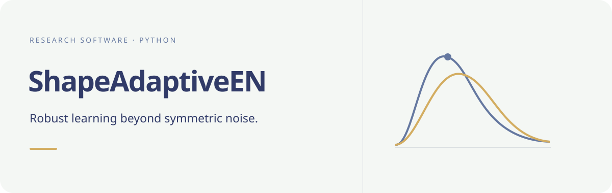

# Shape-adaptive robust regression

*Conceptual illustration; not an estimated residual distribution.*
{.hero-note}

Python estimators for regression under skewness and heavy tails, developed
for the Arashi–Yüzbaşı study *From Residual-Moment Penalties to Shape-Adaptive
Robust Estimation under Skewness and Heavy Tails*.

[Get started](getting-started.md){ .md-button .md-button--primary }
[Explore the API](reference.md){ .md-button }

## Choose an estimator

| Need | Public interface | What to inspect |
|:--|:--|:--|
| Shape-adaptive elastic net | `ShapeAdaptiveEN` | Pilot, bounded-score iteration and CV/refit diagnostics |
| Shape-penalized elastic net | `ShapePenalizedEN` | Shape weights, robust option and convergence output |
| Quantile comparison | `QuantileLasso` | Quantile levels and optimization success |
| Training-data tuning helpers | `fit_en_cv`, `fit_sken_cv`, `fit_quantile_lasso_cv` | Candidate grids, folds and seeds |
| Numerical summary | `diagnostic_summary` | Final KKT residuals and iteration-cap counts |

## Clear boundaries

Version **0.1.0** provides the installable estimator API and a small installation
test. This is a **GitHub distribution, not a PyPI release**. It requires
Python 3.13 and the exact numerical dependency versions in `pyproject.toml`.

The paper's application data, simulation scripts, generated results and
manuscript are not included in this repository. The original providers and
research-verification route are described under
[data and reproducibility](reproducibility.md). No benchmark or general
performance guarantee is implied by this showcase.

## From software to research

The [citation and credit page](citation.md) records authorship and code provenance.
Publication details will be added when verified; no journal DOI is asserted here.
Return to the [author's software catalogue](https://byuzbasi.github.io/en/software/)
to explore related R and Python packages.
